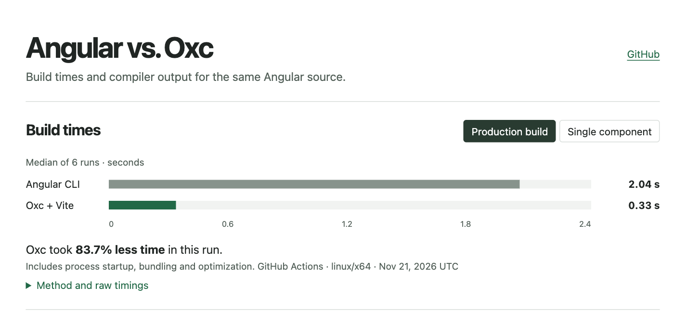

# Angular vs. Oxc

Compare the same Angular source with Angular’s official AOT compiler and the Oxc Angular compiler. Both builds of the demo show the timings, generated template functions and diagnostics side by side.

[Open the Oxc + Vite build](https://nagahara-naoki.github.io/oxc-angular-starter/) · [Open the Angular CLI build](https://nagahara-naoki.github.io/oxc-angular-starter/angular/)

## Benchmark results

Medians from six runs per tool on the same GitHub Actions runner, measured on 2026-11-21 04:34 UTC. The live demo is measured again on each application deployment.

| Workload | Angular | Oxc | Oxc elapsed time vs. Angular |
| --- | ---: | ---: | ---: |
| Production build of this app | 2.04 s | 0.33 s | 83.7% less |
| Compile the signal counter | 346.23 ms | 0.37 ms | 99.9% less |



The production measurement includes process startup, bundling and optimization. Angular CLI and Oxc + Vite use different build pipelines. The single-component measurement uses already-loaded compiler APIs. Angular creates a TypeScript program and type-checks it. Oxc transforms the source of one file. These timings describe this app and these workloads.

**Environment.** linux/x64, AMD EPYC 9V74 80-Core Processor, Node v24.22.3, Angular 22.2.4, Oxc 0.0.45, Vite 8.3.4. Each tool gets one warm-up. Six timed pairs then run sequentially, alternating which tool goes first. Production builds start in a fresh process and project directory with dependencies already installed. [Raw samples for this snapshot](docs/benchmark.json) · [Benchmark run](https://github.com/nagahara-naoki/oxc-angular-starter/actions/runs/44866728744)

## Compiler examples

| Shared input | Angular ngc | Oxc |
| --- | --- | --- |
| [Signal counter](fixtures/counter.ts) | Compiles and increments on click | Compiles and increments on click |
| [Missing animation event phase](fixtures/missing-phase.ts) | Reports `NG5002` for `(@fade)` | Compiles and emits `ɵɵdomListener("fade", …)` |

Change `(@fade)` to `(@fade.done)` and rerun `npm run compare` to see both compilers accept the event. [Upstream issue #726](https://github.com/voidzero-dev/oxc-angular-compiler/issues/726)

## Run locally

Use Node.js 24.22.3 (or run `nvm install` in the repository).

```sh
git clone https://github.com/nagahara-naoki/oxc-angular-starter.git
cd oxc-angular-starter
npm ci
npm start
```

Open <http://localhost:5173> for Oxc + Vite. In a second terminal, run `npm run dev:angular` and open <http://localhost:4200> for Angular CLI.

| Command | Output |
| --- | --- |
| `npm run compare` | Compiles both fixtures and writes the raw code or diagnostics to `.compiler-output/`. |
| `npm run benchmark` | Measures both workloads and replaces the local `public/benchmark.json`. |
| `npm run build:angular` | Builds into `dist/angular/browser/`. |
| `npm run build:oxc` | Builds into `dist/oxc/`. |
| `npm run build` | Builds both applications. |

The [comparison script](scripts/compare.mjs) uses one TypeScript printer for both displayed template functions. The [benchmark script](scripts/benchmark.mjs) runs without a browser. The Angular and Oxc configurations live in [angular.json](angular.json) and [vite.config.ts](vite.config.ts).
